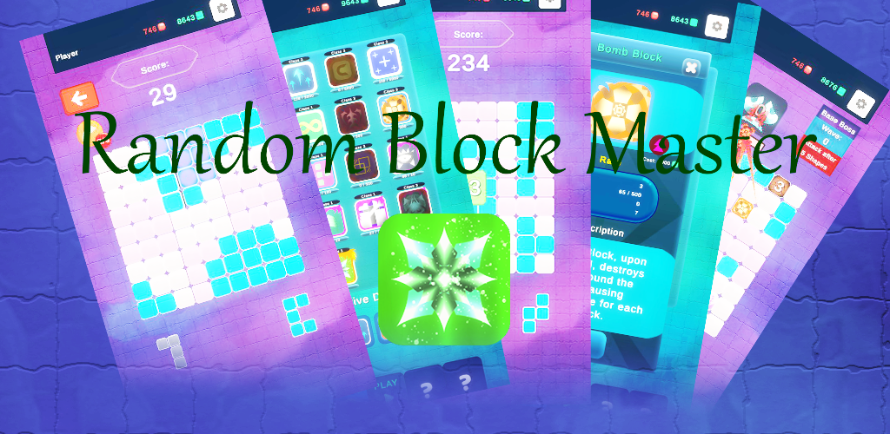
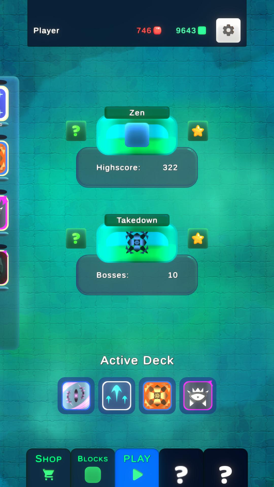
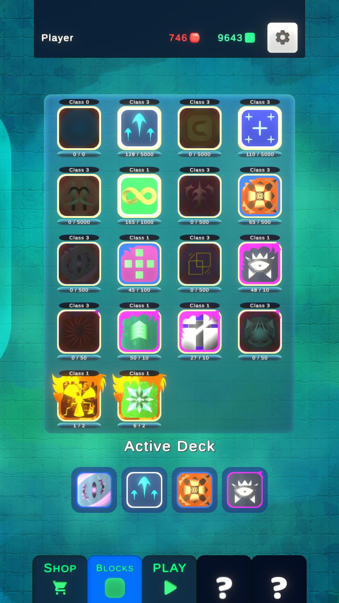
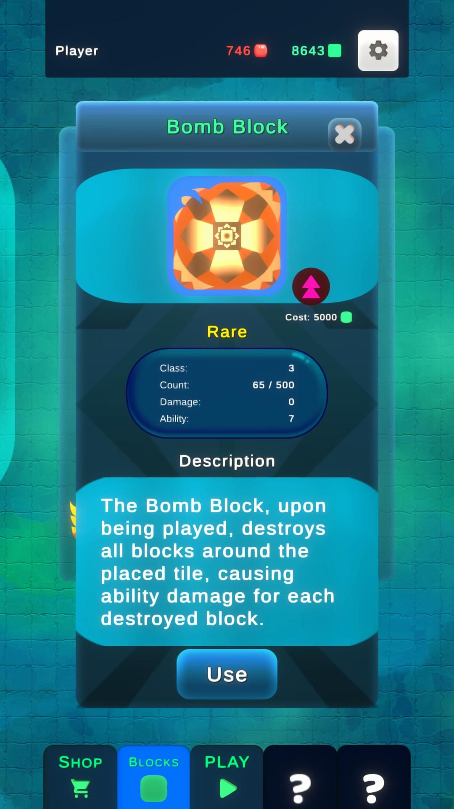
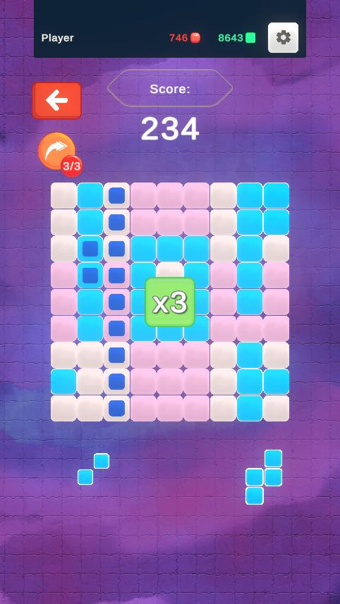
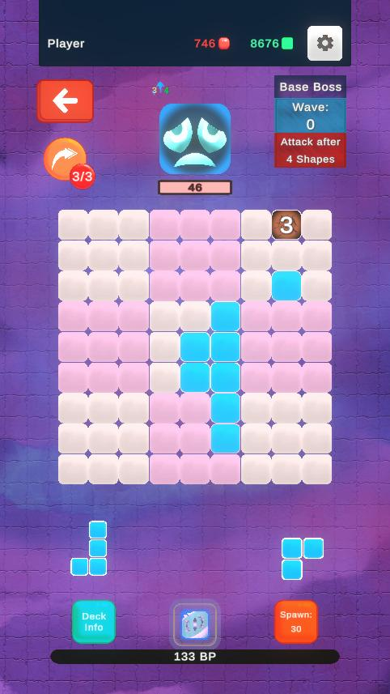
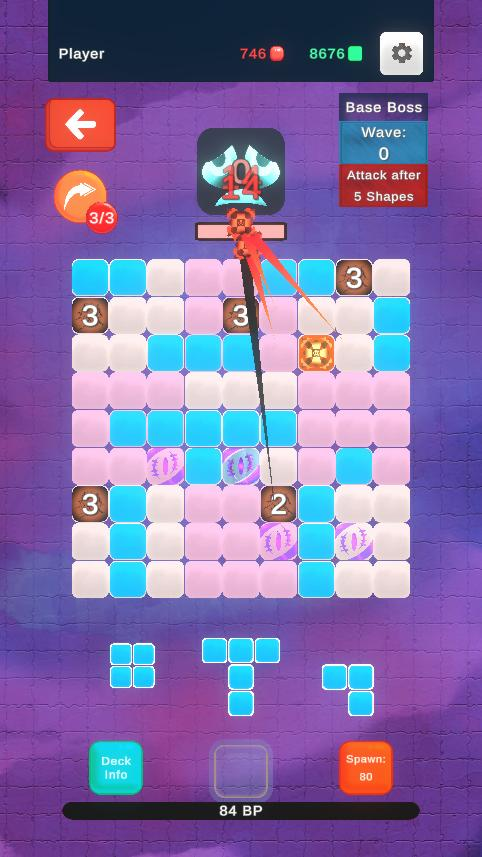

# Random Block Master

  

**Random Block Master** is an archived Android puzzle/strategy game that I developed as a solo hobby project with Unity and C# and previously released on Google Play.

It combines **9x9 grid-based puzzle mechanics** with **collectible and upgradeable ability blocks**, deckbuilding, progression and an endless boss/wave mode. The project was my first larger personal Android game and became an end-to-end learning project across **game design, gameplay programming, UI/UX, backend services and mobile release workflows**.

> **Portfolio note:** This repository is a curated source-code showcase of the original project. It is intentionally **not a complete buildable copy** of the historical Unity project. Production credentials, backend configuration and development-only third-party assets are excluded.

## Game Concept

Players collect blocks with different **rarities, upgrade levels and abilities** and build a four-block deck around the synergies they want to use.

The core puzzle takes place on a **9x9 grid**. Completing rows or 3x3 sections clears parts of the board and creates opportunities for combos. Ability blocks can influence the board when they are cleared, creating additional effects and allowing different deck combinations to play very differently.

The game was designed around two layers:

- **Puzzle layer** — place shapes efficiently, complete rows and 3x3 sections, manage board space and build combos.
- **Deck / ability layer** — collect, upgrade and combine blocks whose abilities interact with the puzzle board.

## Game Modes

### Zen

A score-focused endless puzzle mode built around efficient placements, clears and increasingly strong combos.

### Takedown

A more combat-oriented endless mode with **bosses, waves and block power**. Bosses have health and attacks that can disrupt or block parts of the grid, making it harder to create clears and combos. Strong board setups and ability combinations allow the player to deal damage, survive the pressure and defeat successive bosses.

## Project Highlights

- Solo-developed mobile game from concept to Google Play release
- 9x9 puzzle grid with row and 3x3-section clearing
- Collectible blocks with rarities, upgrade levels and gameplay abilities
- Deckbuilding and ability synergies
- Combo, score and progression systems
- Bosses, waves, health, attacks and board disruption
- ScriptableObject-based game and content data
- Event-driven communication through a ScriptableObject game channel
- Authentication, cloud save and online leaderboards
- Firebase Realtime Database integration
- Android build and Google Play release workflow
- Advertising integration
- Experimental multiplayer/netcode work during development

## My Role

This was a **solo personal project**, so I worked across the full development cycle:

- Game concept and game design
- Gameplay and systems programming
- Block abilities, progression and balancing
- UI/UX design and implementation
- Final in-game art design
- Music and sound design
- Backend/cloud integration
- Android builds and Google Play release
- Advertising integration
- Testing, iteration and maintenance

All final in-game artwork, music and sound effects used in the released game were created by me. Some development-only third-party assets existed in the original private Unity project, but they are not part of this public showcase repository.

## Tech Stack

| Area | Technologies |
| --- | --- |
| Engine | Unity 2021.3 LTS |
| Language | C# |
| Architecture | ScriptableObjects, event-driven game channel, manager-based gameplay systems |
| Online Services | Unity Authentication, Cloud Save, Leaderboards |
| Backend | Firebase Realtime Database |
| Mobile | Android / Google Play |
| Additional | Unity Ads, URP, experimental Unity Netcode |

## Curated Source Code

The files under **source/** are selected parts of the original project that illustrate its architecture and gameplay systems.

| Area | Example |
| --- | --- |
| Event architecture | GameChannel.cs |
| Data-driven design | BlockData.cs, ShapeData.cs, PlayerData.cs |
| Game systems | ComboManager.cs, BlockPowerManager.cs, BossManager.cs |
| Online features | CloudSaveManager.cs, LeaderboardInfo.cs |

The code is preserved primarily as a **historical portfolio sample**. It reflects the state of the project at the time rather than a modernized rewrite.

## Screenshots & Gameplay

### Collection, Deckbuilding & Abilities

  
  
  

### Puzzle & Boss Gameplay

  
  
  

The screenshots above are archived material from the version prepared for the original Google Play release.

## Archived Android Build

A tested archived APK of the playable version is available through the **[v1.0-archive GitHub Release](https://github.com/robin-schneider-dev/random-block-master/releases/tag/v1.0-archive)**.

Backend-dependent functionality may no longer be available because the original online services are no longer maintained.

## Project Status

**Archived / no longer maintained.**

The game was previously available on Google Play for a limited period. I later stopped active development and maintenance, but kept the project as a personal milestone and technical learning project.

## Repository Scope

This public repository intentionally excludes:

- Firebase/production configuration
- API/backend credentials
- Signing keys and keystores
- Development-only third-party assets from the original private project
- Large binary project assets
- The complete historical Unity project

This keeps the repository focused on the parts that are most relevant for a technical portfolio.